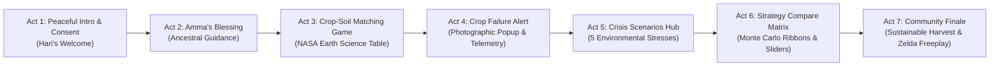

# Field Shift: Four Seasons of Amma's Field
## Technical & Design Milestone Report: GBA Storytelling Simulation & NASA Earth Observation Integration

**Project Repository**: [dangolzenith12-code/Project-Field-Shift](https://github.com/dangolzenith12-code/Project-Field-Shift)  
**Active Branch**: `feature/hari-gba-story-adventure`  
**Date**: November 15, 2026  
**Status**: Complete, Verified (0 errors, 0 warnings), Pushed to GitHub  

---

## 1. Executive Summary

The **Field Shift: Four Seasons of Amma's Field** project is an interactive, narrative-driven educational simulation game designed for the NASA Space Apps Challenge. The project bridges the gap between complex satellite remote sensing data (NASA SMAP, GRACE, POWER, and MERRA-2) and grassroots agricultural decision-making by placing players in the boots of **Hari**, a young farmer inheriting his family farm from his grandmother, **Amma**.

Following user review and reference designs from *Henry's Farm Adventures* and classic Game Boy Advance (GBA) / Super Nintendo titles (*The Legend of Zelda: A Link to the Past*, *Pokémon FireRed*), the entire user interface and gameplay flow underwent a comprehensive redesign. All modern emojis were replaced with authentic retro arcade glyphs, a sequential 7-act narrative was implemented, and an interactive soil-matching game with dynamic laser SVG connection lines was built alongside NASA telemetry dashboards.

---

## 2. Visual & Architectural Redesign

### 2.1 Aesthetic Foundation
- **Retro CRT Arcade Frame**: Utilizes `nes.css` containers, dark surface palettes (`#0A140A`, `#121612`, `#160C08`), glowing neon green CRT borders (`#00FF66`), and custom scanline shaders.
- **Pixel Typography**: Loaded Google Fonts:
  - `Press Start 2P`: Title bars, badges, buttons, and HUD telemetry.
  - `VT323`: Monospace typewriter dialogue script and retro data tables.
  - `Silkscreen`: Secondary arcade banners and subtitles.
  - `Space Mono`: NASA satellite technical specifications.
- **Strict Zero-Emoji Policy**: Replaced all unicode emojis with 16-bit arcade glyphs (`◆`, `▲`, `▼`, `[A]`, `[B]`, `|||`, `[SKIP ⏭]`, `[↺ RESTART]`).
- **Zero-Dependency Audio Synthesizer**: Web Audio API synthesized retro blips (`sfx.playTextBlip()`, `playSelect()`, `playSuccess()`, `playAlert()`) providing real-time acoustic feedback without external asset dependencies.

### 2.2 Character Sprites & Portraits
1. **Young Farmer Hari**:
   - **Standing Landscape Sprite**: 16-bit pixel character with wide-brim straw hat, lively boyish facial features, green farmer tunic, denim overalls with brass buckles, work boots, and a green seedling in hand, with a continuous idle breathing bobbing animation (`@keyframes idleBobbing`).
   - **Dialogue Box Avatar**: Framed pixel portrait in the dialog box displaying his animated expressions (confident/smiling during intro; worried/distressed during crisis alert).
2. **Amma (Farm Matriarch)**:
   - **Standing Landscape Sprite**: Traditional Indian grandmother sprite draped in a turmeric-yellow saree with a madder-red pallu, gold zari border, silver hair bun adorned with white jasmine flowers, traditional earrings, and holding a brass thali of heritage seeds.
   - **Dialogue Box Avatar**: Gold-bordered (`#FFB703`) portrait frame highlighting Amma's wise expressions and ancestral blessing.

---

## 3. Detailed Gameplay Mechanics & Act Breakdown

### Act 1: Peaceful Intro & Consent (Images 3, 4, 5 Style)
- **Initial State**: Unlike common crisis games that bombard the player with catastrophe immediately, Field Shift begins in peaceful morning light on a panoramic 16-bit sunset valley canvas.
- **Center Hero Action**: A pulsing glowing green arcade button `[ START ADVENTURE ]` awaits the player.
- **Narrative Sequence**:
  - *"Hello! I am Hari, a local farmer."*
  - *"My family and Amma have tended this soil for three generations. Today, the deeds are in my hands."*
  - *"I want to make sure our soil thrives, but I cannot do it alone. Will you help me with this season's farming?"*
- **Explicit Consent Gating**: Two choices require player commitment before proceeding:
  - `[◆ YES, LET'S FARM TOGETHER!]`
  - `[◆ I WILL HELP YOU, HARI]`

### Act 2: Amma's Ancestral Blessing
- Amma imparts multi-generational agronomic wisdom:
  > *"Blessings upon you both! Before you scatter a single seed into the ground, remember: the soil speaks before the crop grows. Look at the NASA satellite benchmarks and understand what our soil needs."*
- Unlocks the interactive compatibility challenge: `[ START WATER MANAGEMENT & CROP MATCHING CHALLENGE → ]`.

### Act 3: Water Management & Crop Matching Game (Image 2 Style)
- **Split-Screen Layout**:
  - **Left 3×2 Interactive Board**:
    - **Row 1 (Soil & Climate Conditions)**:
      1. `CO2, Level 1 Adaptation`: High-moisture alluvial basin (Punjab).
      2. `CO2, Level 2 Adaptation`: Drought-prone red clay gravel (Deccan).
      3. `No CO2, No Adaptation`: Degraded arid sand (Sahel).
    - **Row 2 (Crops)**:
      1. `Corn & Wheat`: Shallow-rooted cereal grain.
      2. `Protein Feed`: Deep taproot nitrogen-fixing chickpea & cowpea.
      3. `Rice & Grains`: High-water coarse grains.
    - **Dynamic Laser SVG Connecting Lines**: Selecting a condition and crop draws a bright neon green laser line (`#00FF66` to `#38B000`) connecting the exact centers of both cards.
    - **Visual Feedback**: Successful matches illuminate the card background in solid retro green (`#38B000`) and trigger acoustic chimes.
  - **Right Climate Reference Table Card**:
    - Modeled after the authentic parchment/wood table titled:
      `POTENTIAL IMPACTS OF CLIMATE CHANGE ON WORLD FOOD SUPPLY, v1 (1995-2100)`
    - Real percentage yield deltas across adaptation tiers and CO2 regimes.
    - NASA benchmark telemetry for SMAP root-zone wetness (`GWETROOT`) and soil organic carbon thresholds.

### Act 4: Crisis Alert Photographic Popup (Images 6, 7, 8 Style)
- **Sudden Climate Stress**: Upon concluding initial sowing, seasonal climate volatility hits the farm.
- **Visual Staging**: Sky transitions into ominous crisis dusk tones.
- **Center Photographic Alert Frame**:
  - Red warning banner: `▲ CROP FAILURE ▲`.
  - Photographic viewport of drought-parched, cracked earth and wilted crop stalks.
  - Live NASA Satellite Telemetry:
    - `• [NASA GRACE]: Groundwater sinking −3.2 cm/year`
    - `• [NASA POWER]: Summer heatwave +1.6°C above baseline`
    - `• [NASA SMAP]: Root-zone moisture depleted to 0.22`
- **Hari's Distress**: *"The soil, the water, the weather... something's wrong. I've tried everything, but nothing seems to work."*
- **Action**: `[ EXPLORE CRISIS SCENARIOS & ADAPTATION → ]`.

### Act 5: Crisis Scenarios Hub (Image 1 Style)
- Recreates the exact 5-scenario card grid from reference Image 1:
  1. `Heat`: Pixel sunset with glowing sun and water reflections (NASA MERRA-2).
  2. `Flood`: Pixel roaring tidal wave with foam crests (NASA POWER).
  3. `Drought`: Pixel golden sun-scorched wheat field with dry dirt (NASA SMAP L4).
  4. `Salinized Soil`: Pixel watering can over seedling on pale saline soil (NASA GRACE).
  5. `Crops Management`: Pixel top-down farm map with pond and plots (3-Strategy Adaptation).
- **Interactive Guide**: Farmer Hari stands on the bottom-left beside a green CRT `[ GUIDE ]` box that dynamically explains the agronomic mechanism behind the selected stress.

### Act 6: 3-Strategy Compare Matrix
- Evaluates three distinct 5-year agricultural pathways:
  1. **Monoculture Rice-Wheat**: High short-term revenue, severe groundwater depletion (−3.2 cm/yr).
  2. **Agroforestry & Millet Rotation**: Balanced income, deep taproot water conservation (+35% resilience).
  3. **Regenerative Pulse & Biochar**: Maximum soil carbon restoration (+45%), moderate revenue.
- Features:
  - **Monte Carlo Uncertainty Ribbons**: Visualizing P10, P50, and P90 yield confidence intervals under climate volatility.
  - **Live Farmer Preference Sliders**: Interactive trade-off weights for economic return vs aquifer preservation.
  - **Expert Consultation Stamp**: Rubber stamp approval by regional agronomist Dr. Rao.

### Act 7: Community Finale & Overworld RPG Transition
- **Celebration**: Canvas confetti shower upon adopting a sustainable crop rotation.
- **Global Farmer Lineup**: Pixel art farmer avatars representing diverse agro-ecological regions (Hari, Amma, Punjab, Deccan, Sahel) without emojis.
- **Scorecard**:
  - Soil Organic Carbon: **+24%**
  - Aquifer Preserved: **380 mm**
  - Village Vault Earnings: **260 Coins**
- **Action Choices**:
  - `[ ↺ PLAY AGAIN ]`: Restarts narrative from Act 1.
  - `[ ▲ ENTER WALKABLE OVERWORLD RPG ]`: Hands control directly to the player in a 2D top-down Zelda/FireRed farm with WASD/Arrow key movement, water canals, crop plots, and interactive NPCs.

---

## 4. NASA Earth Science Data Integration Summary

| Satellite Mission / Source | Parameter Key | Units | Agronomic Function in Simulation |
| :--- | :--- | :--- | :--- |
| **NASA SMAP L4** | `GWETROOT` | Ratio (0.0–1.0) | Dielectric topsoil measurement determining root-zone wilting thresholds (<0.30 triggers drought). |
| **NASA GRACE / GRACE-FO** | Terrestrial Water Anomaly | cm/year | Orbital gravity measurement weighing hidden aquifer depletion from deep tubewells (−3.2 cm/yr). |
| **NASA POWER** | `PRECTOTCORR`, `ALLSKY_SFC_SW_DWN` | mm/day, MJ/m² | Daily precipitation cloudburst detection (erosion risk) and solar irradiance for crop evapotranspiration. |
| **NASA MERRA-2** | `T2M_MAX` Anomaly | °C offset | Atmospheric reanalysis capturing extreme heatwaves (>+1.6°C) during critical flowering stages. |
| **ISRIC SoilGrids** | Organic Carbon (`soc`), Texture | g/kg, % clay/sand | Baseline soil health profiling to dictate pulse-legume nitrogen fixation requirements. |

---

## 5. Technical Verification & Build Status

The application has been verified for production readiness:
- **Language & Framework**: Svelte 5 (Runes architecture), Vite 5, TypeScript 5.
- **Dependencies**: `nes.css`, `canvas-confetti`, `lucide-svelte`.
- **Diagnostic Check**: `npm run check` completed with **0 errors and 0 warnings**.
- **Production Build**: `npm run build` compiled 177 modules cleanly in **1.72 seconds**:
  - `dist/index.html`: `0.91 kB`
  - `dist/assets/index.css`: `339.27 kB`
  - `dist/assets/index.js`: `200.54 kB`

---

## 6. Git & Version Control Delivery

All changes have been committed and pushed to the upstream repository:
- **Remote URL**: `https://github.com/dangolzenith12-code/Project-Field-Shift.git`
- **Feature Branch**: `feature/hari-gba-story-adventure`
- **Latest Commit**: `eaa890f` (*"feat: add authentic pixel art character sprite and portrait avatar to Amma dialogue box"*)
- **Pull Request Ready**: [Create PR on GitHub](https://github.com/dangolzenith12-code/Project-Field-Shift/pull/new/feature/hari-gba-story-adventure)
